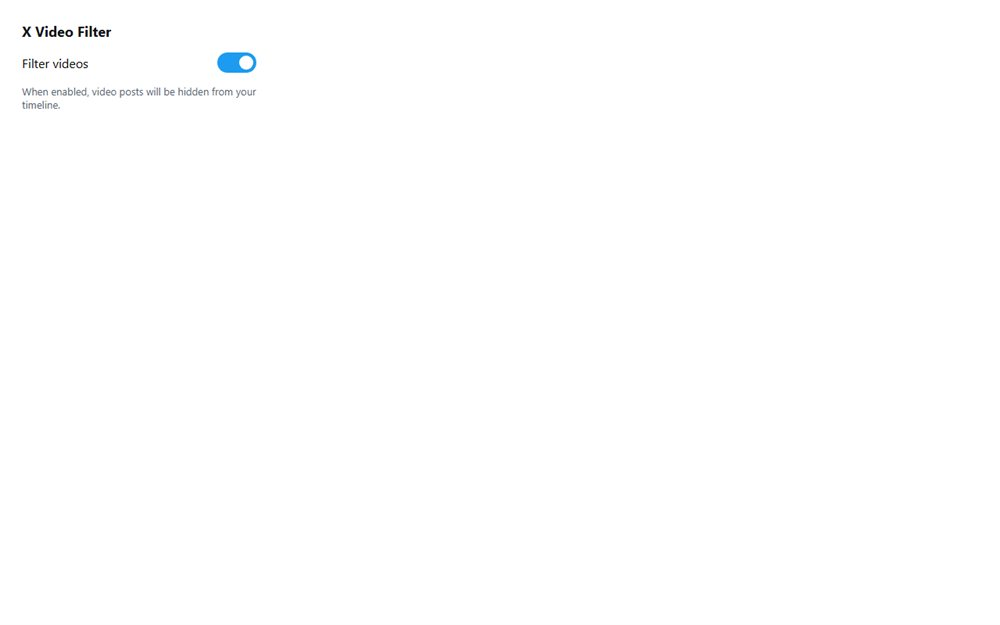

# X Video Filter

A Manifest V3 Chrome extension that hides video posts on your X (Twitter) timeline - one toggle, no server, no tracking.

**[Open the live site](https://ajeet-iitk.github.io/xvideo1/)**

## What it does

X Video Filter watches the timeline on `x.com` / `twitter.com` and hides any post that carries a native video. A single switch in the extension popup turns the filter on or off, and the choice is remembered across sessions with `chrome.storage.sync`.

## How it works

- `content.js` finds `article[data-testid="tweet"]` nodes and hides the ones that ship a video player, a `<video>` element, or an `aria-label` mentioning video.
- A `MutationObserver` on `main[role="main"]` re-runs the filter as new posts stream in, so infinite scroll stays quiet.
- Turning the filter off restores every hidden post immediately.
- `popup.js` only reads and writes the `enabled` key - there is no background worker and no network call.

## Install (unpacked)

1. Download or clone this repository.
2. Open `chrome://extensions` and switch on **Developer mode**.
3. Choose **Load unpacked** and pick this folder.
4. Pin the extension, open x.com, and flip the toggle in the popup.

## Files

| File | Purpose |
| --- | --- |
| `manifest.json` | Manifest V3 definition, content script registration |
| `content.js` | Post filtering plus the timeline observer |
| `popup.html` / `popup.js` | The on/off switch |
| `index.html` | Static preview of the popup UI (what GitHub Pages serves) |
| `icon16/48/128.png` | Toolbar icons |

## About the live link

GitHub Pages hosts `index.html`, a static preview of the popup so the interface can be seen without installing anything. The actual filtering only happens once the extension is loaded in the browser.

---

Part of [my collection of small projects](https://github.com/Ajeet-iitk).
